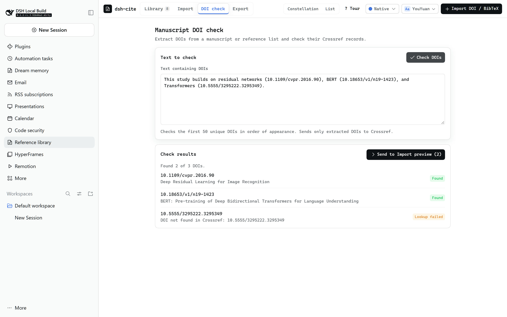

[简体中文](README.md) · **English**

# Cite

**DeepSeek Harness citation workbench: arrange papers on an interactive Spatial Citation Constellation, preview live citations on a floating Zettelkasten card, or switch to the classic 3-pane list in 1 click.**

Built for DeepSeek Harness `>=0.2.2-rc.3`, with 13 switchable daylight-friendly workbench styles and 8 font pairings (defaulting to YouYuan Mono, synced across plugins) plus a soft-slate dark mode.

[](https://www.npmjs.com/package/dsh-cite) [](https://www.npmjs.com/package/dsh-cite) [](https://www.npmjs.com/package/dsh-cite)

**[Install](#install) · [Workflow](#start-using-it) · [Full guide](https://github.com/STARDUSTLC666/dsh-cite/blob/master/docs/REFERENCE.en.md)**

## Screenshots

[](docs/assets/screenshots/library-en.jpg)

| Import preview and deduplication | DOI check |
| --- | --- |
| [](docs/assets/screenshots/import-en.jpg) | [](docs/assets/screenshots/doi-check-en.jpg) |

*Captured with `dsh-cite` Spatial Citation Constellation running in Harness Web `0.2.2-rc.3`.*

## Features

- **Default Spatial Citation Constellation + 1-click classic List toggle**: Papers lay out deterministically without overlapping across a full-bleed dot-matrix starfield, connected by curved SVG filaments for shared authors, venues, eras (±2y), and Crossref clusters. Drag any node smoothly while filaments follow in real time, click to spotlight `✦` neighbors while dimming unrelated works, or toggle back to the classic 3-pane **List** view anytime.
- **Floating Zettelkasten Index Card & inline metadata editing**: Preview live `GB/T 7714`, `APA`, `IEEE`, `MLA`, or `Chicago` citations in the bottom-right HUD with 1-click **Copy citation**, **Copy BibTeX**, **Enrich from Crossref**, and **Edit metadata** (atomic revision-checked updates with duplicate-DOI guards), plus Raw source inspection and safe removal.
- **Offline import preview & deduplication**: Preview duplicates and missing fields locally before importing a DOI list or BibTeX, with a 1-click **Fill sample BibTeX / DOI** starter.
- **Crossref DOI check & 1-click handoff**: Verify manuscript DOIs against Crossref and send valid DOIs straight to Import preview, or fill missing fields on saved references while keeping local conflict diffs.
- **Interactive `? Tour` spotlight coachmark**: 4-step constellation-aware guide in the topbar covering the floating capsule, draggable nodes & filaments, Zettelkasten card actions, and appearance/batch tools, with 1-click chat prompt copy.
- **13 workbench styles & 8 font pairings**: Synced across plugins and portaled modals/menus, honoring DSH `>=0.2.2-rc.3` host primitives, frame clearances, and `prefers-reduced-motion: reduce`.

## Install

Open **Plugins** in the DSH desktop app and install `dsh-cite`. If the CLI is available:

```bash
dsh plugin --profile desktop add dsh-cite
```

For the web profile, replace `desktop` with `web`. Restart that DSH profile after installation. The package’s DSH requirement is `>=0.2.2-rc.3`.

## Start using it

<picture>
  <source media="(prefers-color-scheme: dark) and (max-width: 640px)" srcset="https://raw.githubusercontent.com/STARDUSTLC666/dsh-cite/master/docs/assets/intro/workflow-en-mobile-dark.svg">
  <source media="(max-width: 640px)" srcset="https://raw.githubusercontent.com/STARDUSTLC666/dsh-cite/master/docs/assets/intro/workflow-en-mobile-light.svg">
  <source media="(prefers-color-scheme: dark)" srcset="https://raw.githubusercontent.com/STARDUSTLC666/dsh-cite/master/docs/assets/intro/workflow-en-dark.svg">
  
</picture>

### Typical workflow: from Spatial Constellation to submission-ready bibliography

1. **Check your draft or load a sample**: Open **Reference library** in the sidebar to land on the **Spatial Citation Constellation**. Paste manuscript text in **DOI check** to verify DOIs against Crossref and click **Send to Import preview** to carry valid DOIs over—or click **Fill sample BibTeX / DOI** in **Import** to populate the starfield right away.
2. **Explore & arrange the Constellation**: Drag any paper node across the dot-matrix canvas while curved SVG filaments follow shared authors, venues, publication eras (±2y), and Crossref clusters live. Use the top-left **Floating Control Capsule** to highlight search matches or filter by quality, or toggle to the classic 3-pane **List** view in 1 click for multi-select batch actions.
3. **Enrich & refine on the Floating Zettelkasten Card**: Click any node to spotlight its `✦` neighborhood, then click **Enrich from Crossref** (filling empty fields while retaining local diffs) or **Edit metadata** in the bottom-right Zettelkasten HUD to revise title, authors, year, venue, or DOI; click **Remove** to delete entries safely with revision-conflict protection.
4. **Copy citations & export backups**: Switch between `GB/T 7714`, `APA`, `IEEE`, `MLA`, and `Chicago` to copy formatted citations or BibTeX in 1 click, or open **Export** to download `.bib`, `.txt`, and full `.json` source backups.

Reopen **`? Tour`** in the topbar anytime for an interactive walkthrough, or send ready-made prompts to DSH chat:

- `Verify this paper’s DOI and metadata, then import it into my citation library`
- `Read my local citation library (cite_batch list) and format a clean GB/T 7714 bibliography, noting any missing fields.`
- `Read my local citation library (cite_batch list), format the bibliography in APA style, and check year, volume, and page completeness.`

## Before you start

Enrichment requires Crossref access; verify bibliographic fields and citation formatting before delivery.

Configuration, detailed tools and troubleshooting: [full reference](https://github.com/STARDUSTLC666/dsh-cite/blob/master/docs/REFERENCE.en.md).

## Plugin updates

Check updates at the bottom of the workbench or native plugin details. Automatic checks are on by default; **automatic installation is off**. You choose whether to install and when to restart. Suite-managed components update with their bundle. [Update behavior](https://github.com/STARDUSTLC666/dsh-cite/blob/master/docs/REFERENCE.en.md).

## Documentation

- [Full usage, configuration and limits](https://github.com/STARDUSTLC666/dsh-cite/blob/master/docs/REFERENCE.en.md)
- [Release notes](https://github.com/STARDUSTLC666/dsh-cite/blob/master/CHANGELOG.md)
- [Validation scope and history](https://github.com/STARDUSTLC666/dsh-cite/blob/master/docs/VALIDATION.md)

## Feedback and contributions

If the plugin helps, a Star makes it easier for others to discover. Report problems or suggest improvements in [Issues](https://github.com/STARDUSTLC666/dsh-cite/issues); code and documentation [PRs](https://github.com/STARDUSTLC666/dsh-cite/pulls) are welcome. Include versions and reproduction steps, and remove credentials from reports.

## License

[MIT](https://github.com/STARDUSTLC666/dsh-cite/blob/master/LICENSE)

<a id="what-it-does"></a>
<a id="requirements-and-configuration"></a>
