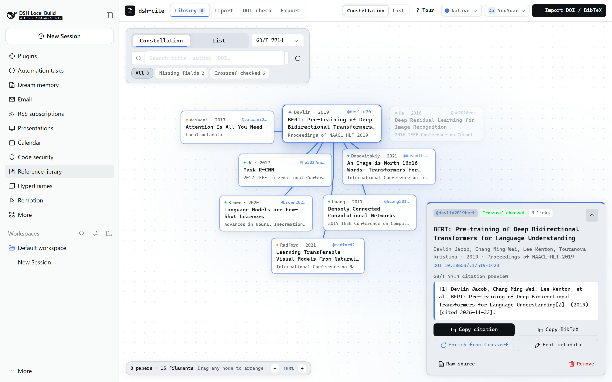

[简体中文](README.md) · **English**

# Cite

**DeepSeek Harness citation workbench: organize references, check DOIs, export citations, and back up original sources in a three-pane library.**

Built for DeepSeek Harness `>=0.2.2-rc.3`, with five switchable light/warm workbench styles (Harness Native, Cream Paper, Claude Warm, 8-Bit Pixel, Mint Air) synced across plugins plus a soft-slate dark mode.

[](https://www.npmjs.com/package/dsh-cite) [](https://www.npmjs.com/package/dsh-cite) [](https://www.npmjs.com/package/dsh-cite)

**[Install](#install) · [Workflow](#start-using-it) · [Full guide](https://github.com/STARDUSTLC666/dsh-cite/blob/master/docs/REFERENCE.en.md)**

## Screenshots

[](docs/assets/screenshots/library-en.jpg)

| Import preview and deduplication | DOI check |
| --- | --- |
| [](docs/assets/screenshots/import-en.jpg) | [](docs/assets/screenshots/doi-check-en.jpg) |

*Captured with `dsh-cite 0.9.3` running in Harness Web `0.2.2-rc.3` (Claude Warm style).*

## Features

- Filter, search, and inspect references in a three-pane library, copy formatted citations or BibTeX entries, inspect raw records in a native modal, and safely remove single or selected entries with revision-conflict protection.
- Preview duplicates and missing fields locally before importing a DOI list or BibTeX, with a 1-click **Fill sample BibTeX / DOI** starter.
- Check manuscript DOIs against Crossref (and send verified DOIs directly to Import preview in 1 click), or fill gaps in saved references and review differences.
- Expand the compact **How it works: 4-step citation workflow** bar at the top of the workbench to copy ready-to-send DSH chat prompts.
- Export selected references or the entire library. Download a full backup with the original sources.
- Switch between five workbench styles (Harness Native, Cream Paper, Claude Warm, 8-Bit Pixel, Mint Air) synced to portaled dialogs and menus, adapted to DSH `>=0.2.2-rc.3` host primitives and frame clearances.

## Install

Open **Plugins** in the DSH desktop app and install `dsh-cite`. If the CLI is available:

```bash
dsh plugin --profile desktop add dsh-cite
```

For the web profile, replace `desktop` with `web`. Restart that DSH profile after installation. The package’s DSH requirement is `>=0.2.2-rc.3`.

## Start using it

<picture>
  <source media="(prefers-color-scheme: dark) and (max-width: 640px)" srcset="https://raw.githubusercontent.com/STARDUSTLC666/dsh-cite/master/docs/assets/intro/workflow-en-mobile-dark.svg">
  <source media="(max-width: 640px)" srcset="https://raw.githubusercontent.com/STARDUSTLC666/dsh-cite/master/docs/assets/intro/workflow-en-mobile-light.svg">
  <source media="(prefers-color-scheme: dark)" srcset="https://raw.githubusercontent.com/STARDUSTLC666/dsh-cite/master/docs/assets/intro/workflow-en-dark.svg">
  
</picture>

### Typical workflow: from finding papers to final bibliography

1. **Check your draft or load a sample**: Open **Reference library** in the sidebar. Paste manuscript text in **DOI check** to verify DOIs against Crossref and click **Send to Import preview** to carry valid DOIs over—or click **Fill sample BibTeX / DOI** in **Import** to test the flow immediately.
2. **Preview & deduplicate locally**: Run **Local preview** offline to catch library duplicates, repeated batch DOIs, and missing fields before saving selected references.
3. **Enrich & clean up**: Select entries in **Library** to run **Crossref enrichment** (preserving local edits and highlighting differences), or click **Remove** to delete unwanted/duplicate entries with confirmation and revision protection.
4. **Format & back up for submission**: Switch between `GB/T 7714`, `APA`, `MLA`, and `Chicago` to copy formatted citations, or open **Export** to download `.bib`, `.txt`, and full `.json` source backups.

You can also expand the workflow bar inside the workbench to copy ready-made DSH chat prompts in one click:

- `Use cite_check to verify every DOI in my draft below against Crossref and list any missing or invalid references:`
- `Read my local citation library (cite_batch list) and format a clean GB/T 7714 bibliography, noting any missing fields.`
- `Read my local citation library (cite_batch list), format the bibliography in APA style, and check year, volume, and page completeness.`

## Before you start

Enrichment requires Crossref access; verify bibliographic fields and citation formatting before delivery.

Configuration, detailed tools and troubleshooting: [full reference](https://github.com/STARDUSTLC666/dsh-cite/blob/master/docs/REFERENCE.en.md).

## Plugin updates

Check updates at the bottom of the workbench or native plugin details. Automatic checks are on by default; **automatic installation is off**. You choose whether to install and when to restart. Suite-managed components update with their bundle. [Update behavior](https://github.com/STARDUSTLC666/dsh-cite/blob/master/docs/REFERENCE.en.md).

## Documentation

- [Full usage, configuration and limits](https://github.com/STARDUSTLC666/dsh-cite/blob/master/docs/REFERENCE.en.md)
- [Release notes](https://github.com/STARDUSTLC666/dsh-cite/blob/master/CHANGELOG.md)
- [Validation scope and history](https://github.com/STARDUSTLC666/dsh-cite/blob/master/docs/VALIDATION.md)

## Feedback and contributions

If the plugin helps, a Star makes it easier for others to discover. Report problems or suggest improvements in [Issues](https://github.com/STARDUSTLC666/dsh-cite/issues); code and documentation [PRs](https://github.com/STARDUSTLC666/dsh-cite/pulls) are welcome. Include versions and reproduction steps, and remove credentials from reports.

## License

[MIT](https://github.com/STARDUSTLC666/dsh-cite/blob/master/LICENSE)

<a id="what-it-does"></a>
<a id="requirements-and-configuration"></a>
