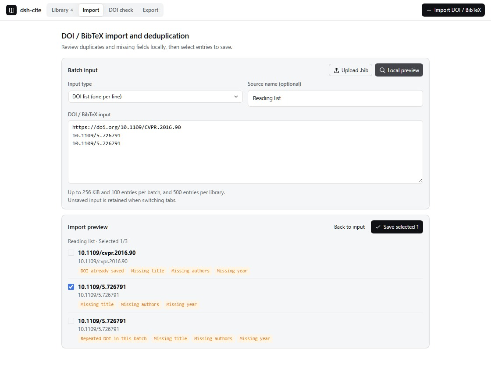

[简体中文](README.md) · **English**

# Cite

**Organize references, check DOIs, and export citations in DeepSeek Harness.**

[](https://www.npmjs.com/package/dsh-cite) [](https://www.npmjs.com/package/dsh-cite) [](https://www.npmjs.com/package/dsh-cite)

**[Install](#install) · [Workflow](#start-using-it) · [Full guide](https://github.com/STARDUSTLC666/dsh-cite/blob/master/docs/REFERENCE.en.md)**

## Screenshots

[](docs/assets/screenshots/library-en.jpg)

| Import preview and deduplication | DOI check |
| --- | --- |
| [](docs/assets/screenshots/import-en.jpg) | [](docs/assets/screenshots/doi-check-en.jpg) |

*Captured with `dsh-cite 0.8.0` running in Harness Web `0.2.2-rc.3`.*

## Features

- Filter, search, and inspect references in a three-pane library. Copy a formatted citation or its BibTeX entry.
- Preview duplicates and missing fields locally before importing a DOI list or BibTeX.
- Check manuscript DOIs against Crossref, or fill gaps in saved references and review differences.
- Export selected references or the entire library. Download a full backup with the original sources.

## Install

Open **Plugins** in the DSH desktop app and install `dsh-cite`. If the CLI is available:

```bash
dsh plugin --profile desktop add dsh-cite
```

For the web profile, replace `desktop` with `web`. Restart that DSH profile after installation. The package’s DSH requirement is `>=0.2.2-rc.3`.

## Start using it

<picture>
  <source media="(prefers-color-scheme: dark) and (max-width: 640px)" srcset="https://raw.githubusercontent.com/STARDUSTLC666/dsh-cite/master/docs/assets/intro/workflow-en-mobile-dark.svg">
  <source media="(max-width: 640px)" srcset="https://raw.githubusercontent.com/STARDUSTLC666/dsh-cite/master/docs/assets/intro/workflow-en-mobile-light.svg">
  <source media="(prefers-color-scheme: dark)" srcset="https://raw.githubusercontent.com/STARDUSTLC666/dsh-cite/master/docs/assets/intro/workflow-en-dark.svg">
  
</picture>

1. Open Citations in the sidebar and prepare DOI entries or a BibTeX file.
2. Preview the import locally; inspect entries, duplicates and fields before saving selected references.
3. Select entries and explicitly request Crossref enrichment when needed, then review the returned fields.
4. Select references, export a bibliography or BibTeX, and download a library backup when needed.

Example request：

> Look up these DOI records and highlight fields I should verify.

## Before you start

Enrichment requires Crossref access; verify bibliographic fields and citation formatting before delivery.

Configuration, detailed tools and troubleshooting: [full reference](https://github.com/STARDUSTLC666/dsh-cite/blob/master/docs/REFERENCE.en.md).

## Plugin updates

Check updates at the bottom of the workbench or native plugin details. Automatic checks are on by default; **automatic installation is off**. You choose whether to install and when to restart. Suite-managed components update with their bundle. [Update behavior](https://github.com/STARDUSTLC666/dsh-cite/blob/master/docs/REFERENCE.en.md).

## Documentation

- [Full usage, configuration and limits](https://github.com/STARDUSTLC666/dsh-cite/blob/master/docs/REFERENCE.en.md)
- [Release notes](https://github.com/STARDUSTLC666/dsh-cite/blob/master/CHANGELOG.md)
- [Validation scope and history](https://github.com/STARDUSTLC666/dsh-cite/blob/master/docs/VALIDATION.md)

## Feedback

If the plugin helps, a Star makes it easier for others to discover. Report problems or suggest improvements in [Issues](https://github.com/STARDUSTLC666/dsh-cite/issues). Include versions and reproduction steps, and remove credentials from reports.

## License

[MIT](https://github.com/STARDUSTLC666/dsh-cite/blob/master/LICENSE)

<a id="what-it-does"></a>
<a id="requirements-and-configuration"></a>
