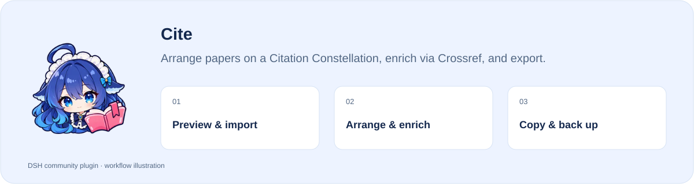

[简体中文](README.md) · **English**

# Cite

> **Arrange papers on a Spatial Citation Constellation, verify DOIs via Crossref, and export submission-ready citations.**

Citation workbench for DeepSeek Harness (`>=0.2.2-rc.3`) combining an interactive constellation canvas, a floating Zettelkasten index card HUD, 1-click classic 3-pane List toggle, and 13 bright styles × 8 fonts.

[](https://www.npmjs.com/package/dsh-cite) [](https://www.npmjs.com/package/dsh-cite) [](https://www.npmjs.com/package/dsh-cite)

**[Features](#features) · [Screenshots](#screenshots) · [Install](#install) · [Workflow](#start-using-it) · [Full guide](https://github.com/STARDUSTLC666/dsh-cite/blob/master/docs/REFERENCE.en.md)**

## Screenshots

[](docs/assets/screenshots/library-en.jpg)

| Import preview and deduplication | DOI check |
| --- | --- |
| [](docs/assets/screenshots/import-en.jpg) | [](docs/assets/screenshots/doi-check-en.jpg) |

*Captured with `dsh-cite` Spatial Citation Constellation running in Harness Web `0.2.2-rc.3`.*

## Features

| Pillar | Capabilities |
| :--- | :--- |
| **Spatial Citation Constellation** | Deterministic non-overlapping starfield with live curved SVG filaments for shared authors, venues, eras (±2y) & Crossref clusters; drag nodes, spotlight `✦` neighbors, or toggle to classic 3-pane **List** |
| **Zettelkasten Index Card HUD** | Live `GB/T 7714` / `APA` / `IEEE` / `MLA` / `Chicago` preview with 1-click Copy citation, Copy BibTeX, Crossref enrich & atomic metadata editing (revision & duplicate-DOI guarded) |
| **Offline Import Preview** | Detects in-library duplicates, batch duplicates, and missing fields offline before importing DOI lists or BibTeX, with a 1-click sample starter |
| **Crossref DOI Check** | Verifies manuscript DOIs and sends valid matches straight to Import preview; fills empty fields while preserving local diffs and raw source backups |
| **Tour & Synced Themes** | 4-step `? Tour` spotlight guide, 13 bright styles & 8 font pairings (default: style-matched font) synced across plugins and portaled dialogs |

## Install

Open **Plugins** in the DSH desktop app and install `dsh-cite`, or use the CLI:

```bash
dsh plugin --profile desktop add dsh-cite
```

For the web profile, replace `desktop` with `web` and restart DSH. Requires DSH `>=0.2.2-rc.3`.

## Start using it

<picture>
  <source media="(prefers-color-scheme: dark) and (max-width: 640px)" srcset="https://raw.githubusercontent.com/STARDUSTLC666/dsh-cite/master/docs/assets/intro/workflow-en-mobile-dark.svg">
  <source media="(max-width: 640px)" srcset="https://raw.githubusercontent.com/STARDUSTLC666/dsh-cite/master/docs/assets/intro/workflow-en-mobile-light.svg">
  <source media="(prefers-color-scheme: dark)" srcset="https://raw.githubusercontent.com/STARDUSTLC666/dsh-cite/master/docs/assets/intro/workflow-en-dark.svg">
  
</picture>

1. **Check a draft or load a sample**: Open **Reference library**; paste manuscript DOIs into **DOI check** and send valid matches to Import preview, or click **Fill sample BibTeX / DOI**.
2. **Explore the Constellation**: Drag paper nodes to arrange clusters, search or filter from the top-left capsule, and switch to **List** view in 1 click for multi-select batch actions.
3. **Enrich & edit metadata**: Click a node to spotlight its `✦` neighborhood, then click **Enrich from Crossref**, **Edit metadata**, or safe **Remove** on the Zettelkasten card.
4. **Export citations & backups**: Switch across 5 citation styles for 1-click copy, or download `.bib`, bibliography text, and full `.json` source backups in **Export**.

### Ready-to-copy prompts

- **Verify & import**: `Verify this paper’s DOI and metadata, then import it into my citation library`
- **GB/T 7714 list**: `Read my local citation library (cite_batch list) and format a clean GB/T 7714 bibliography, noting any missing fields.`
- **APA check**: `Read my local citation library (cite_batch list), format the bibliography in APA style, and check year, volume, and page completeness.`

## Before you start

- Online lookup requires Crossref access; review metadata and citation formatting before final submission.
- Full configuration, tools, and troubleshooting: [full reference](https://github.com/STARDUSTLC666/dsh-cite/blob/master/docs/REFERENCE.en.md).

## Plugin updates

Check updates at the bottom of the workbench or native plugin details. Automatic checks are on by default; **automatic installation is off**. Suite-managed components update with their bundle.

## Documentation & feedback

- [Full usage, configuration and limits](https://github.com/STARDUSTLC666/dsh-cite/blob/master/docs/REFERENCE.en.md) · [Release notes](https://github.com/STARDUSTLC666/dsh-cite/blob/master/CHANGELOG.md) · [Validation history](https://github.com/STARDUSTLC666/dsh-cite/blob/master/docs/VALIDATION.md)
- Stars, [Issues](https://github.com/STARDUSTLC666/dsh-cite/issues), and [PRs](https://github.com/STARDUSTLC666/dsh-cite/pulls) are welcome (strip credentials first).

## License

[MIT](https://github.com/STARDUSTLC666/dsh-cite/blob/master/LICENSE)

<a id="what-it-does"></a>
<a id="requirements-and-configuration"></a>
