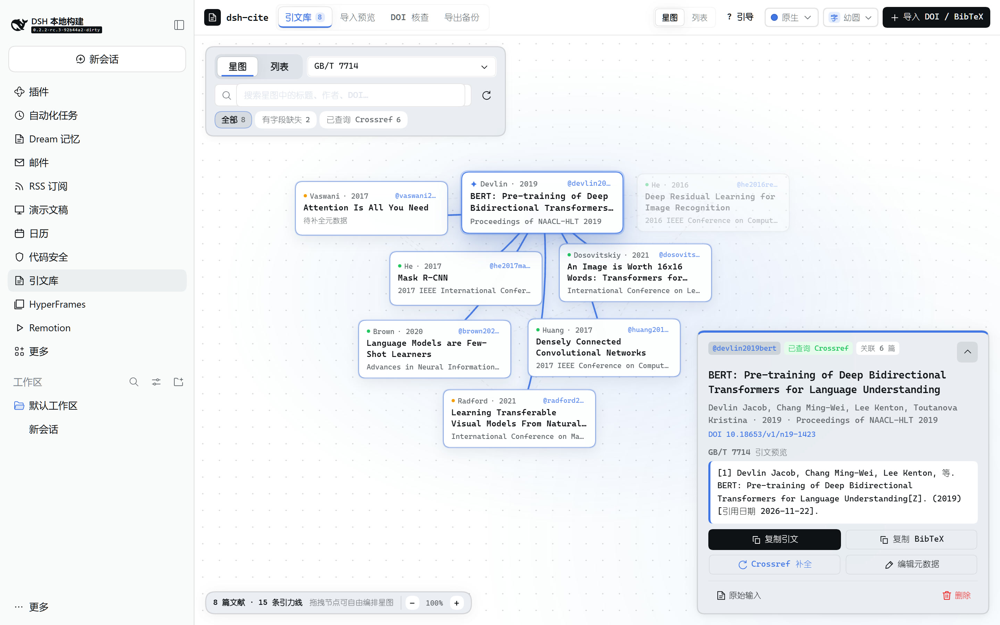
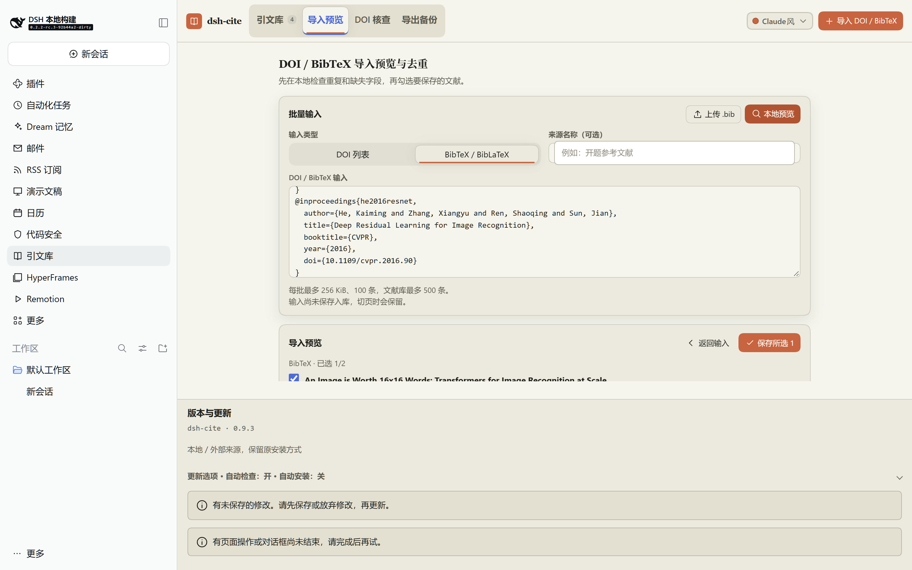

**简体中文** · [English](README.en.md)

# Cite

**DeepSeek Harness 引文工作台：在三栏工作台中整理文献、核查 DOI、导出引文并备份原始来源。**

适配 DeepSeek Harness `>=0.2.2-rc.3`，提供原生清透、米白纸感、Claude 暖书卷、8-Bit 像素与晴空薄荷 5 套可切换浅色/暖色工作台风格（支持跨插件同步）及柔和岩板深色模式。

[](https://www.npmjs.com/package/dsh-cite) [](https://www.npmjs.com/package/dsh-cite) [](https://www.npmjs.com/package/dsh-cite)

**[安装使用](#安装) · [使用流程](#开始使用) · [完整说明](https://github.com/STARDUSTLC666/dsh-cite/blob/master/docs/REFERENCE.zh.md)**

## 界面截图

[](docs/assets/screenshots/library-zh.jpg)

| 导入预览与去重 | DOI 核查 |
| --- | --- |
| [](docs/assets/screenshots/import-zh.jpg) | [](docs/assets/screenshots/doi-check-zh.jpg) |

*截图来自 Harness Web `0.2.2-rc.3` 中运行的 `dsh-cite 0.9.3`（Claude 暖书卷风格）。*

## 功能

- 在三栏文献库筛选、搜索和查看文献，复制引文或 BibTeX，在详情弹窗查看原始题录来源，并支持带版本冲突保护的单条/批量删除。
- 导入 DOI 列表或 BibTeX 前，支持一键填入示例题录，并在本地预览重复项与缺失字段。
- 通过 Crossref 核查文稿中的 DOI（核查通过后可一键送入导入预览），或补全已存文献的空字段并查看差异。
- 工作台顶部内置可折叠「4 步管理论文引用」指南与一键复制的对话指令标签。
- 导出所选文献或全库引文，下载包含原始来源的完整备份。
- 内置 5 套工作台视觉风格（原生清透 / 米白纸感 / Claude 暖书卷 / 8-Bit 像素 / 晴空薄荷），同步至弹层菜单与弹窗，适配 DSH `>=0.2.2-rc.3` 宿主控件与窗口留白。

## 安装

在 DSH 桌面版「插件」面板安装 `dsh-cite`。已配置命令行时也可使用：

```bash
dsh plugin --profile desktop add dsh-cite
```

网页版把 `desktop` 改为 `web`；安装后重启对应的 DSH。宿主要求以包声明 `>=0.2.2-rc.3` 为准。

## 开始使用

<picture>
  <source media="(prefers-color-scheme: dark) and (max-width: 640px)" srcset="https://raw.githubusercontent.com/STARDUSTLC666/dsh-cite/master/docs/assets/intro/workflow-zh-mobile-dark.svg">
  <source media="(max-width: 640px)" srcset="https://raw.githubusercontent.com/STARDUSTLC666/dsh-cite/master/docs/assets/intro/workflow-zh-mobile-light.svg">
  <source media="(prefers-color-scheme: dark)" srcset="https://raw.githubusercontent.com/STARDUSTLC666/dsh-cite/master/docs/assets/intro/workflow-zh-dark.svg">
  
</picture>

### 典型使用流程：从查文献到定稿排版

1. **核查初稿或试水示例**：从左侧栏打开「引文库」。若手上已有论文初稿，切到「DOI 核查」粘贴文稿校验真伪，核查通过的 DOI 可点**「送入导入预览」**一键带入；首次体验也可直接在「导入预览」点**「填入示例 DOI / BibTeX」**。
2. **本地预览去重后入库**：点击「本地预览」，离线检查库内重复、同批重复与缺失字段，勾选确认无误的文献保存入库。
3. **Crossref 补全与清理误导入**：在「引文库」勾选缺字段条目执行「Crossref 补全」（保留本地已有值并对比差异）；若导入了错误或多余文献，可在详情栏或批量栏点击「删除」并在弹窗确认移除。
4. **一键定稿排版与来源备份**：切换 `GB/T 7714`、`APA`、`MLA` 或 `Chicago` 直接复制标准引文，或在「导出备份」下载 `.bib`、参考文献文本与含原始输入的完整 `.json` 备份。

工作台顶部可展开「怎么用最顺手：4 步管理论文引用」，点击指令气泡即可复制给 DSH 对话助手，例如：

- `请用 cite_check 核查我这段论文初稿中的所有 DOI 是否在 Crossref 真实存在，并列出缺失或异常条目：`
- `请读取我的本地引文库（cite_batch list），按 GB/T 7714 格式整理成可直接粘贴到论文末尾的参考文献列表，并提醒字段缺失项。`
- `请读取我的本地引文库（cite_batch list），按 APA 格式输出参考文献列表，并检查年份、卷期和页码是否完整。`

## 开始前要知道

联网补全需要访问 Crossref；引用格式与文献信息仍应在交付前核对。

配置、完整工具与排错见[详细使用说明](https://github.com/STARDUSTLC666/dsh-cite/blob/master/docs/REFERENCE.zh.md)。

## 插件更新

在工作台或原生插件详情页底部检查更新。默认自动检查，**默认不自动安装**；是否安装、何时重启由你决定。Suite 管理的组件随整包更新。[查看更新规则](https://github.com/STARDUSTLC666/dsh-cite/blob/master/docs/REFERENCE.zh.md)。

## 文档

- [详细使用、配置与边界](https://github.com/STARDUSTLC666/dsh-cite/blob/master/docs/REFERENCE.zh.md)
- [更新记录](https://github.com/STARDUSTLC666/dsh-cite/blob/master/CHANGELOG.md)
- [验证范围与历史](https://github.com/STARDUSTLC666/dsh-cite/blob/master/docs/VALIDATION.md)

## 反馈与贡献

如果插件帮到了你，欢迎 Star，让更多人发现它。问题和建议请提交 [Issues](https://github.com/STARDUSTLC666/dsh-cite/issues)，也欢迎代码与文档 [PR](https://github.com/STARDUSTLC666/dsh-cite/pulls)。反馈时附上版本与复现步骤，并移除凭据。

## License

[MIT](https://github.com/STARDUSTLC666/dsh-cite/blob/master/LICENSE)

<a id="依赖与配置"></a>
