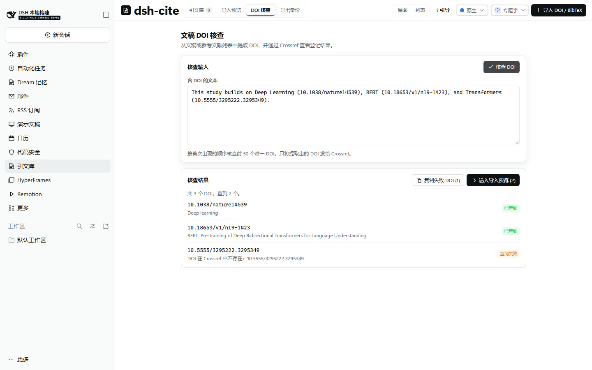

**简体中文** · [English](README.en.md)

# Cite

> **在「文献引力星图」中拖拽编排文献、核查 DOI、1 键消解 Crossref 差异并直接复制或导出投稿级引文。**

DeepSeek Harness（`>=0.2.2-rc.3`）离线优先学术引文工作台与 **6 个 AI 智能体工具**：融合可拖拽/滚轮缩放的**文献引力星图画布**、**悬浮 Zettelkasten 索引卡**与经典三栏排序列表（1 键切换），覆盖 **5 种主流引文格式 × 14 类学术文献**，内置 13 套明亮风格 × 8 套双层字体（默认跟随风格专属字）。

[](https://www.npmjs.com/package/dsh-cite) [](https://github.com/STARDUSTLC666/dsh-cite/actions/workflows/ci.yml) [](https://www.npmjs.com/package/dsh-cite) [](https://www.npmjs.com/package/dsh-cite) [](https://github.com/STARDUSTLC666/dsh-cite/blob/master/LICENSE)

**[核心能力](#核心能力) · [界面截图](#界面截图) · [AI 智能体工具](#ai-智能体工具) · [安装](#安装) · [快速上手](#开始使用) · [完整说明](https://github.com/STARDUSTLC666/dsh-cite/blob/master/docs/REFERENCE.zh.md)**

<picture>
  <source media="(prefers-color-scheme: dark) and (max-width: 640px)" srcset="https://raw.githubusercontent.com/STARDUSTLC666/dsh-cite/master/docs/assets/intro/workflow-zh-mobile-dark.svg">
  <source media="(max-width: 640px)" srcset="https://raw.githubusercontent.com/STARDUSTLC666/dsh-cite/master/docs/assets/intro/workflow-zh-mobile-light.svg">
  <source media="(prefers-color-scheme: dark)" srcset="https://raw.githubusercontent.com/STARDUSTLC666/dsh-cite/master/docs/assets/intro/workflow-zh-dark.svg">
  
</picture>

## 核心能力

| 模块 | 核心特性 |
| :--- | :--- |
| **文献引力星图画布** | 确定性空间哈希无重叠布局（满载 500 篇文献依旧毫秒级 0 重叠），实时绘制同作者 / 同刊物 / 同期（±2 年）/ 状态聚类 SVG 引力线（支持悬停高亮与关系提示、大图密度上限）；支持自由拖拽、指针锚点滚轮缩放、`◎` 居中定位、搜索自动平移与 1 键切回经典三栏排序「列表」 |
| **悬浮 Zettelkasten 索引卡** | 实时渲染 `GB/T 7714` / `APA` / `IEEE` / `MLA` / `Chicago` 引文（同时兼容 Crossref 与 CSL-JSON 14 类文献类型），1 键复制引文与 BibTeX（含 `@incollection` / `@proceedings` / `isbn`）、Crossref 补全、**星图内直出差异徽章与 1 键「采用」**，以及全字段原子编辑（含 ISBN/语言、年份校验与 409 冲突刷新不丢草稿） |
| **离线导入预览与去重** | 粘贴 DOI / BibTeX 或直接**拖放 `.bib` 文件**入库（不干扰文本拖拽），在独立 Worker 沙箱内离线检测库内重复、同批重复、疑似重题与缺失字段；支持「全选可导项 / 清空勾选」与 1 键填入示例题录体验 |
| **Crossref DOI 核查与差异消解** | 批量并发核查论文初稿中的前 50 个唯一 DOI，通过项 1 键送入导入预览、失败项 1 键复制回文稿排查；补全只填空字段、绝不覆盖本地值，星图索引卡与列表差异表均支持**逐字段 1 键「采用」**并自动清理已消解冲突 |
| **1 键复制、定稿导出与溯源备份** | 「导出备份」页支持按全部或所选范围进行缺失体检，提供参考文献与 BibTeX **1 键「复制全部」**与 `.txt`/`.bib` 下载，以及包含全部未映射原始输入的 `.json` 完整溯源备份；任意条目支持按需查看原始导入文本 |
| **6 工具联动与跨插件主题** | 注册 6 个模型工具（含 `cite_batch` 全动作 `update` / `source` / `remove` 原子操作），内置 4 步 `? 引导` 聚光灯导览与 **13 套明亮风格（含刷新后的晴空薄荷、晴昼琉璃、晴空水晶与云母流光）× 8 套双层字体**（默认跟随风格专属字） |

## 界面截图

[](https://raw.githubusercontent.com/STARDUSTLC666/dsh-cite/master/docs/assets/screenshots/library-zh.jpg)

| 导入预览与去重 | DOI 核查 |
| --- | --- |
| [](https://raw.githubusercontent.com/STARDUSTLC666/dsh-cite/master/docs/assets/screenshots/import-zh.jpg) | [](https://raw.githubusercontent.com/STARDUSTLC666/dsh-cite/master/docs/assets/screenshots/doi-check-zh.jpg) |

*截图来自 Harness Web `0.2.2-rc.3` 中运行的 `dsh-cite` 文献引力星图工作台。*

## AI 智能体工具

<details open>
<summary>展开查看：6 个内置模型工具与离线/安全边界速查</summary>

| 工具 | 作用 | 网络 / 边界 |
| :--- | :--- | :--- |
| `cite_lookup` | 按 DOI 精确查询或按标题/作者/刊名检索 Crossref 题录 | Crossref REST API（无需 API Key，2 MiB 有界流式读取） |
| `cite_format` | 按 DOI 生成 `gb-t-7714` / `apa` / `ieee` / `mla` / `chicago` 引文 | Crossref REST API，支持 `zh` / `en` |
| `cite_bibtex` | 按 DOI 生成清洗引用键与 LaTeX 转义后的 BibTeX 条目 | Crossref REST API，自动处理机构作者与复合姓氏 |
| `cite_check` | 提取文稿中最多 50 个唯一 DOI 并 3 并发保序校验真伪 | 只读校验，仅发送提取出的 DOI，不修改文献库 |
| `cite_health` | 探测 Crossref API 连通性与延迟 | 最小探活请求，立即释放响应体 |
| `cite_batch` | 操作本地文献库（`list` / `source` / `preview` / `import` / `enrich` / `update` / `remove` / `job` / `cancel` / `export`） | `preview` / `import` / `update` / `remove` / `export` 全程离线；文件锁 + 修订号 409 冲突保护 |

- **隐私与容量边界**：离线解析运行于独立受限 Worker（5 秒超时、64 MiB 堆上限）；单批最多 `256 KiB` / `100` 条，库最多 `500` 条、文件上限 `8 MiB`；绝不上传 `.bib` 文件、原始来源或整库。

</details>

## 安装

在 DSH 桌面版「插件」面板搜索安装 `dsh-cite`，或使用命令行：

```bash
dsh plugin --profile desktop add dsh-cite
```

网页版将 `desktop` 改为 `web`，安装后重启 DSH。宿主要求：`>=0.2.2-rc.3`（Node `^22.19.0 || >=24.0.0`）。

## 开始使用

1. **核查初稿或试水示例**：打开左侧栏「引文库」；在「DOI 核查」粘贴文稿校验真伪并将通过项一键送入导入预览（失败项一键复制排查），或在「导入预览」拖放 `.bib` 文件 / 点击「填入示例 DOI / BibTeX」快速体验。
2. **星图梳理与检索**：在星图画布自由拖拽节点、滚轮缩放或点击 `◎` 居中选中节点；用左上悬浮控制台即时高亮搜索、按质量筛选，或 1 键切回支持多维排序与批量操作的经典「列表」视图。
3. **补全、消解差异与修订**：在右下 Zettelkasten 索引卡执行「Crossref 补全」「编辑元数据」（含 ISBN / 语言与年份校验）、「原始输入」查看或安全确认删除；若 Crossref 与本地值存在差异，可直接在星图索引卡或列表详情差异表中逐字段 1 键「采用」。
4. **定稿复制与备份**：切换 5 种引文格式单条复制，或在「导出备份」体检缺失字段后 1 键「复制全部」或下载 `.bib`、`.txt` 及含全部原始输入的 `.json` 备份。

### 常用对话示例

- **核查并入库**：`帮我核验这篇论文的 DOI 与真实元数据并导入引文库`
- **输出国标参考文献**：`读取本地引文库（cite_batch list），按 GB/T 7714 格式整理参考文献列表，并提醒字段缺失项。`
- **输出 APA 并体检**：`读取本地引文库（cite_batch list），按 APA 格式输出参考文献，并检查年份、卷期和页码是否完整。`
- **批量校验文稿引用**：`用 cite_check 检查下面参考文献列表中每个 DOI 是否真实存在，并列出失效条目。`

## 开始前要知道

- 本地导入、去重、编辑、格式化与备份全程离线；仅在显式执行 Crossref 核查/补全或查询工具时访问 Crossref（无需 API Key）。
- 参考文献格式基于 5 套主流学术模板生成，正式投稿或毕业论文提交前请按目标期刊/学校细则复核。
- 详细配置（`timeoutMs` / `userAgent` / `hideWorkbench`）、工具参数与排错见 [完整说明](https://github.com/STARDUSTLC666/dsh-cite/blob/master/docs/REFERENCE.zh.md) 与 [使用说明](https://github.com/STARDUSTLC666/dsh-cite/blob/master/docs/USAGE.md)。

## 插件更新

在工作台或原生插件详情页底部检查更新。默认自动检查，**默认不自动安装**；有未保存修改或弹窗编辑时自动暂停更新，Suite 管理的组件随整包更新。

## 文档与反馈

- [完整使用、配置与边界](https://github.com/STARDUSTLC666/dsh-cite/blob/master/docs/REFERENCE.zh.md) · [工作台与源码说明](https://github.com/STARDUSTLC666/dsh-cite/blob/master/docs/WORKBENCH.md) · [更新记录](https://github.com/STARDUSTLC666/dsh-cite/blob/master/CHANGELOG.md) · [验证历史](https://github.com/STARDUSTLC666/dsh-cite/blob/master/docs/VALIDATION.md)
- 欢迎 Star、提交 [Issues](https://github.com/STARDUSTLC666/dsh-cite/issues) 与 [PR](https://github.com/STARDUSTLC666/dsh-cite/pulls)（反馈请附版本与复现步骤，并移除凭据）。

## License

[MIT](https://github.com/STARDUSTLC666/dsh-cite/blob/master/LICENSE)

<a id="依赖与配置"></a>
